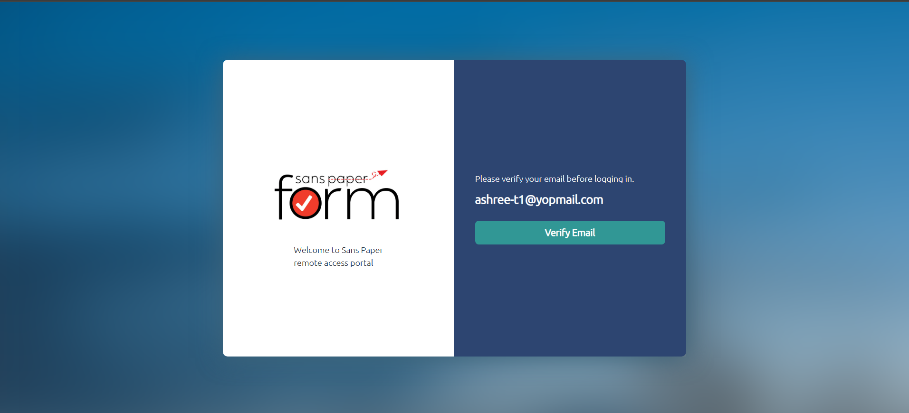

## Version v1.2.3+build-c808f0ea
- Date released: 19-11-2026

1. Fix PDF and submitted form view errors when fields have empty values.

2. Fix organization ID not being saved on form submissions.

3. Only the form owner or Super Admin can now delete form templates.

4. Fix onboarding details not being saved before redirecting to Sans Paper ID login.

## Version v1.2.1+build-2a0fd08e
- Date released: 16-11-2026

1. Fix dates on emailed PDF to match the downloaded PDF.

2. Show readable text instead of numbers in form builder custom email text.

3. Rename Group libraries to Categories.

4. Save dates in UTC in the database.

5. Automate metadata.json file generation.

6. Remove unused Auth0 M2M tokens and access tokens.

## Version v1.1.42+build-0a0100d5
- Date released: 11-11-2026

1. Fix draft answers for Hazards and Control Measures.

2. Fix Maps page missing forms and add zoom buttons.

3. Fix event form bug.

4. Update Node version.

## Version v1.1.41+build-69c1133c
- Date released: 05-10-2026

1. Fix role switcher after login and when switching organization.

2. Fix Super Admin role when switching organization.

3. Add Order Trails for organization switch and Super Admin role changes.

4. Fix login showing all organizations.

5. Fix role list and "Show more" button on Form Template Library.

6. Fix email not being sent.

7. Fix conditional required fields and active organization on My Forms submission.

8. Fix logo aspect ratio in generated PDF.

## Version v1.1.40+build-e55d9786
- Date released: 18-09-2026

1. Add attachment component with PDF viewer on submitted forms.

2. Multiple bug fixes and UX enhancements for submitted forms, filters and PDF generation.

3. Fix switching user from other web apps.

4. Fix logging out page.

5. Fix form viewer modal on Maps page.

## Version v1.1.39+build-f3b1c4f6
- Date released: 24-07-2026

1. Fix mobile UI for all pages.

## Version v1.1.38+build-c0cd8f8d
- Date released: 20-07-2026

1. Fix public form issue - Endless login.

2. Fix public form issue - Public form link redrection error.

3. Subform new feature - Subform now can select date range of the forms to be included at the parent form.

## Version v1.1.37+build-e550acb8
- Date released: 20-05-2026

1. Fix AI chat issue.

2. Add recent libraries inside the AI Chat auto create function.

3. Add option to send user invite email to contacts.

4. Add bulk invite option to send user invites to multiple contacts at once.

## Version v1.1.36+build-7ed6dbc2
- Date released: 19-03-2026

1. Bugfix: Duplicate templates project selection do not show all projects.

2. Bugfix: Error on duplicate templates function.

3. Bugfix: Error on "Save as draft" function on form submission.

4. Bugfix: Form values on filter template is not cleared after clicking "X" button.

5. Bugfix : Error on saving links on project page.

6. Increase text field size for label in form builder for type Section, Label and Header.

7. Change loading indicator to plane icon in form builder.

## Version v1.1.35+build-a41b6fad
- Date released: 23-02-2026

1. Implement a user interface feature that allows users to resend the Auth0 verification email if their email address has not yet been verified.

## Version v1.1.34+build-619e5686
- Date released: 13-01-2026

1. Add chat limit and rag index for all organizations. Rag index is the Azure Machine Learning index that is used for Inferece Chat function.

2. SUPERADMIN can modify the chat limit and add new entry for rag index on any organization.

3. Change the CopilotKit sidebar chat to use the new SansPaper AI Chat App which is hosted on Azure.

4. AI Chats now shows the messages and responses on the Order Trails page.
