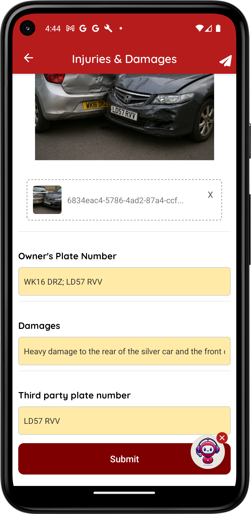
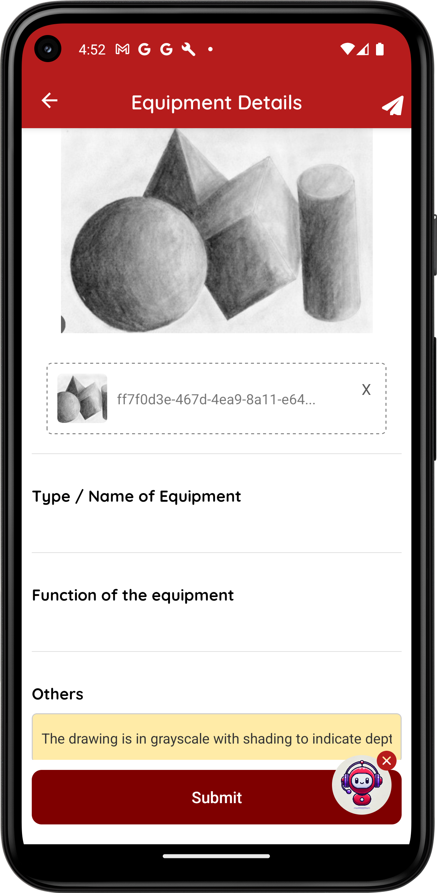
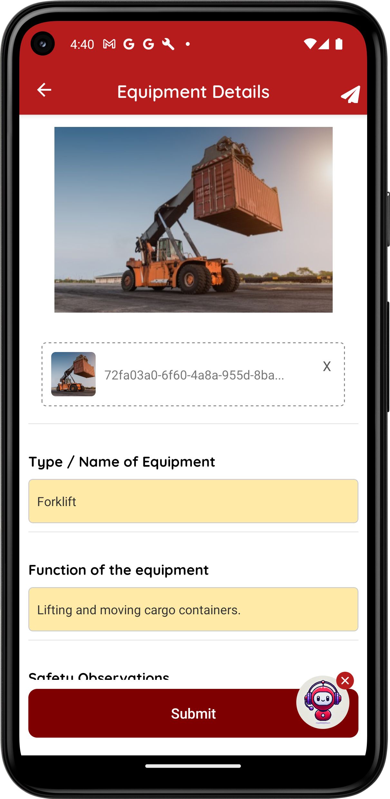
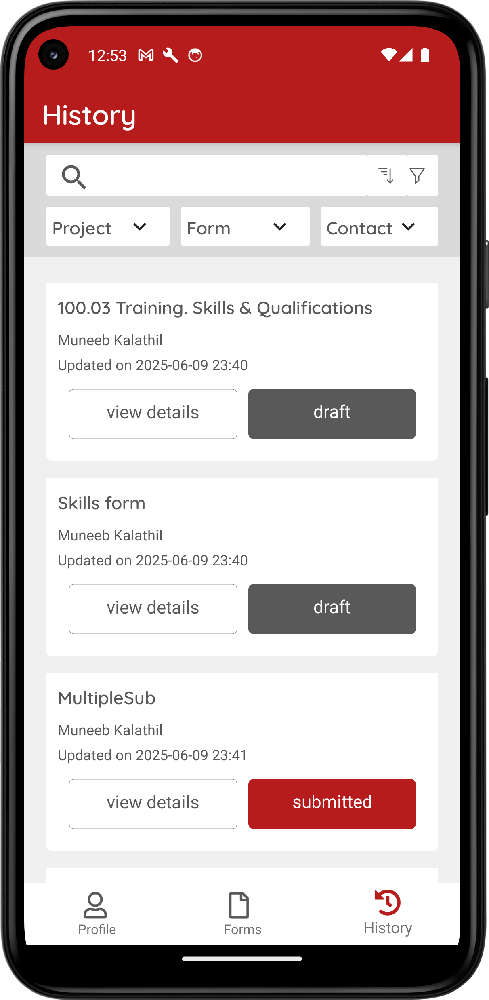
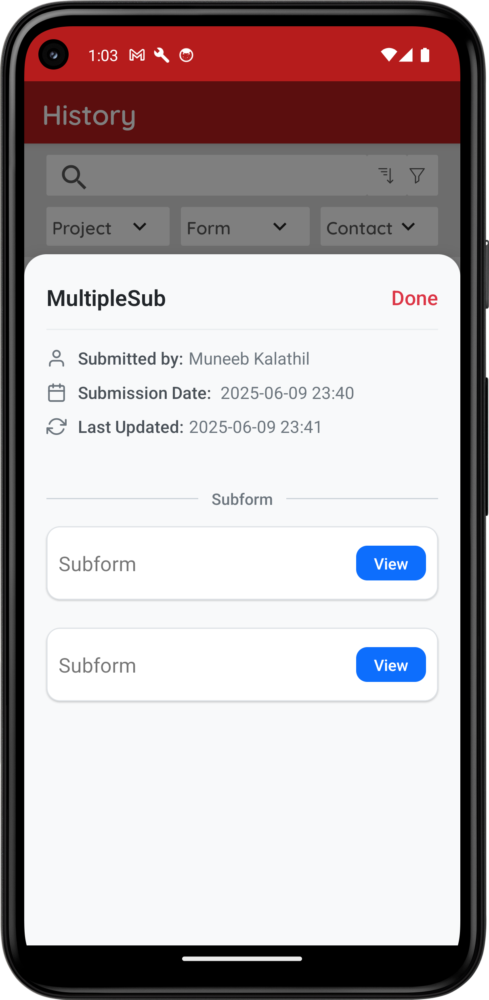
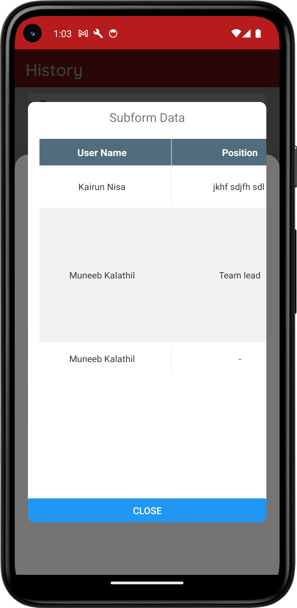

## **Release Date**: 05th August 2025
Version Android (1250) & iOS (763)  

## 🚀 Features Releasing

### 🔹 Deep Linking 
- Between Sans Paper Form and Sans Paper ID (Mobile)
- When the user taps the Add Skill button in Sans Paper ID, it will open the Sans Paper Form app.
- If the app is not installed, the user will be redirected to the App Store/Google Play Store to install it.

### 🔹 SSO
- Now supports Single Sign-On (SSO) on mobile.

  🔵 🔵 🔵 NEXT SECTION 🔵 🔵 🔵

## **Release Date**: 12th July 2025
Version Android (1243) & iOS (751)  

## 🚀 Features Releasing

### 🔹 PhotoAI Field
- Now support multiple selection

### 🔹 General Photo Field
- Now support multiple selection

### 🔹 Hazards MultiSelect 
- Hazards MultiSelect is a library that will be autoselected by the value from Worktype Library.
- Hazards library can only be use together with Worktype library

### 🔹 Control Measure MultiSelect
- Control Measure MultiSelect is a library that will be autoselected by the value from Hazards Library.
- Control measure library can only be use together with Hazards library

  🔵 🔵 🔵 NEXT SECTION 🔵 🔵 🔵

## **Release Date**: 20th June 2025
Version Android (1239) & iOS (747)  

## 🚀 Features Releasing

### 🔹 PhotoAI Field
- new AI-powered element that extracts data from uploaded images and automatically fills in the corresponding form fields. 
- Unlike the regular photo field, this version supports multiple image uploads and intelligently matches extracted data to the most suitable input fields.
- This tool simplifies form-filling by allowing users to upload photos, after which the AI will autofill form fields. 
- Users can then review or edit the pre-filled data as needed.
- Following are the examples

  

  
      
Textual

      

  

  
      
Drawing/Sketch

      

  

  
      
Visual

      

  🔵 🔵 🔵 NEXT SECTION 🔵 🔵 🔵

## **Release Date**: 10th June 2025
Version Android (1221) & iOS (745)  

## 🚀 Features Releasing

### 🔹 Subform
- Subform now can support multiple forms
- Only manager role can see the subform details
- When save main form, the triggered subform will be saved as draft and can be viewed in History screen

  

- Manager can click View Details and see list of subform, user assigned to filled in etc

  
  

